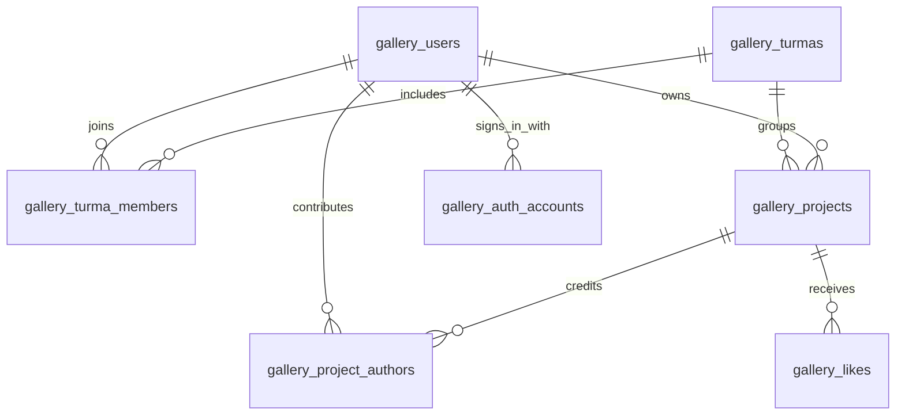

# Toti Gallery

A gallery of learning projects from the Toti community, with project discovery,
community profiles, likes, and project publishing and editing.
The interface is in Brazilian Portuguese (pt-BR).

## Stack

- Next.js App Router, React, and TypeScript
- Tailwind CSS and shared custom CSS in `src/app/globals.css`
- PostgreSQL with Drizzle ORM
- npm with a committed `package-lock.json`

## Local setup

Requirements: Node.js 20.9 or later, npm, and PostgreSQL.

Use the dedicated Neon `development` branch. Sample data is not created
automatically, and public registration is disabled.

```sh
npm ci
cp .env.example .env.local
```

Set `DATABASE_URL` to `development / toti_gallery`, fill in its Neon resource IDs,
and generate a separate `BETTER_AUTH_SECRET`. Use `http://localhost:3000` for
`BETTER_AUTH_URL`. The development copy already contains the current schema;
do not rerun historical cutover migrations. See [Environments](docs/environments.md)
for connection guards and temporary test setup. Start the development server:

```sh
npm run dev
```

Open the Local URL printed by Next.js, normally `http://localhost:3000`.
`GET /api/health` checks database connectivity.

## Commands

| Command | Purpose |
| --- | --- |
| `npm run dev` | Start the development server |
| `npm run typecheck` | Check TypeScript without emitting files |
| `npm run lint` | Run ESLint |
| `npm run build` | Create a production build |
| `npm start` | Serve a completed production build |
| `npm run test:database-target` | Check environment guards without a database |
| `npm run test:auth` | Check authentication on an explicitly prepared temporary test branch |

## Project structure

```text
src/app/         Pages, route handlers, and global styles
src/components/  Shared interface components
src/db/          Database connection and schema
src/lib/         Authentication, queries, validation, and utilities
public/          Static assets
```

## Database

The application uses PostgreSQL on Neon. The current code model is defined in
[src/db/schema.ts](src/db/schema.ts); [migrations](migrations/README.md) record
its evolution and are applied separately to each environment.

See the [Database guide](docs/database.md) for a field-by-field reference,
relationship diagram, and explanations of access, authorship, and deletion rules.

### Environments

Neon **branches** are isolated environments; PostgreSQL **databases** live inside
each branch. Identical database names on different branches do not share writes.

| Branch | Purpose |
| --- | --- |
| `production` | The public Vercel application, using `toti_gallery` |
| `development` | Local development, using its own copy of `toti_gallery` |
| `test/*` | Temporary copies for migration checks and automated tests |

`toti_gallery_legacy` retains historical data and is not the application's current
database. Connection guards and operating procedures are documented in
[Environments](docs/environments.md).

### Core tables

| Table | What it stores |
| --- | --- |
| `gallery_users` | One permanent profile per person: unique email, name, photo, bio, GitHub, role and access status. Students and staff use the same table. |
| `gallery_turmas` | Course groups: unique turma number, display name, course name, start year and optional archive date. |
| `gallery_turma_members` | Memberships between people and turmas. The pair `(turma_id, user_id)` is unique, so one person can join several turmas without duplicate memberships. |
| `gallery_projects` | One publication: title, description, technologies, cover, links, publication owner (`author_id`), turma (`turma_id`), final-project flag and moderation fields. |
| `gallery_project_authors` | Credits for the owner and any coauthors. Each `(project_id, user_id)` pair appears once. |
| `gallery_likes` | Visitor likes. Each `(project_id, visitor_key)` pair appears once; likes do not require a registered user account. |

The main relationships are:



For example, a final project made by six students has **one project record**,
one publication owner, and six authorship links. It appears once in the gallery
and in each author's profile. `is_final` is independent of the number of authors:
both individual and group projects can be final projects.

New coauthors must be active participants of the project's turma. Later membership
changes or turma archiving preserve existing project credits. Archived turmas
remain available for browsing and publishing.

Only the publication owner can edit or delete the project; coauthors can leave it.
Administrators control `published` / `hidden` visibility, with a reason and the
latest moderator/time. Hiding preserves the project, authors and likes. Deleting
a project removes its authorship links and likes; foreign keys prevent deleting
a referenced publication owner or turma as an implicit way to remove projects.

### Authentication and access tables

| Table | What it stores |
| --- | --- |
| `gallery_auth_accounts` | Better Auth sign-in methods linked to `gallery_users`: Google identity and/or email/password credentials. Passwords are stored as hashes. |
| `gallery_auth_sessions` | Login sessions linked to a user, including session token and expiration. |
| `gallery_auth_verifications` | Temporary Better Auth verification records with an identifier, value and expiration. |
| `gallery_auth_rate_limits` | Request counters used for server-side authentication throttling. |
| `gallery_invitations` | One-time activation and password-recovery grants: recipient, issuing administrator, purpose, token hash, expiration, and use/revocation timestamps. Raw links are not stored here. |

A person signing in with Google and with a password still has **one user profile**;
the separate sign-in records point to that same user ID. The first Google sign-in
activates an existing approved profile rather than creating a second person.

User roles are `user`, `admin` and `owner`, with at most one owner enforced by the
database. Access status is separately tracked as `pending`, `active` or `suspended`.
`is_demo` identifies demonstration profiles, which cannot sign in.

## Development guidelines

See [AGENTS.md](AGENTS.md) for contribution and agent instructions.
See [User stories](docs/user-stories.md) for a simple overview of user goals,
implemented features, and planned improvements.
Keep credentials in `.env.local`, which is ignored by Git. Use `.env.example` to
document required variables with placeholder values, and never commit secrets.

## Accounts

Better Auth supports administrator-provisioned email/password and optional Google
Sign-In on the same profile. Activation and recovery use single-use links delivered
manually; no email service is required. Existing demonstration profiles cannot sign in.

See [Authentication](docs/authentication.md) for the first-administrator command,
isolated review environment, account provisioning and migrations. See
[Google on Vercel](docs/google-vercel-check.md) for the public OAuth check.

Staff access administration at `/admin/turmas`, `/admin/estudantes` and
`/admin/projetos`. See
[Administration](docs/administration.md) for permissions, imports and migrations.
