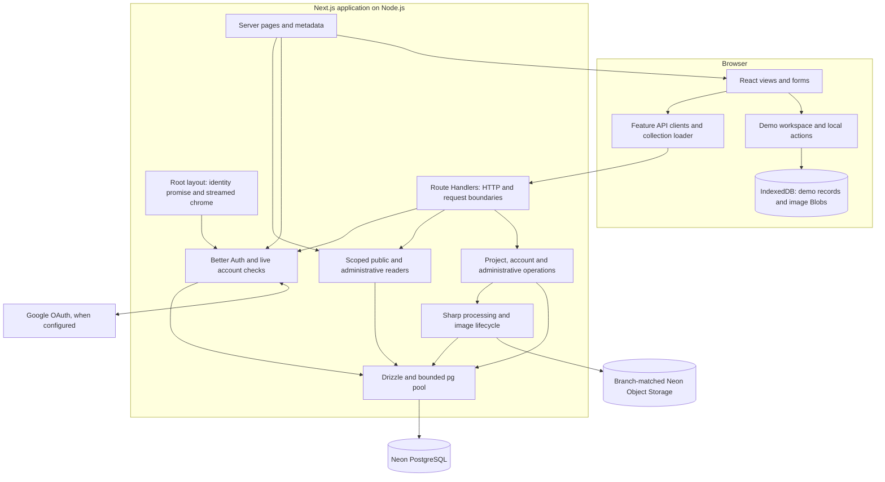
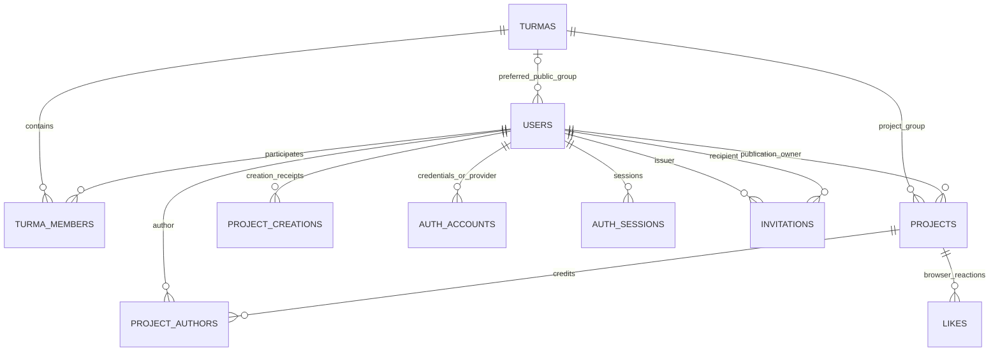

# Architecture audit

**Reviewed:** 2026-11-08 · **Repository:** `b3a75f7` (`docs/agent-guidance`).

This is an assessment of the checked-out implementation, not a deployment certification. No application code, configuration, databases or migrations were changed. No cloud queries, deployment, dependency installation or database-writing tests were performed. The requested report is the only repository addition; the pre-existing untracked `.vscode/` directory was left untouched.

## 1. Overall judgment

Toti Gallery has a sound architecture for a small, closed-registration community platform. It is a **single Next.js application with feature-oriented server modules**, not a collection of disconnected CRUD screens. PostgreSQL is the authority for accounts, permissions and publications; Object Storage holds immutable processed images; IndexedDB provides a genuinely separate demonstration workspace.

**No fundamental redesign is justified.** Keep Next.js App Router, Drizzle/node-postgres, Better Auth and the existing feature operations. Microservices, a generic repository/service framework, a second API backend, a global client data cache, or a mandatory form/table library would not solve the issues identified here.

The implementation is suitable for controlled real use with the operational limits below understood. Before treating it as a dependable official platform, close the gaps in regression enforcement, recovery and diagnostics, and extend stale-write protection to the remaining replacement forms. These are targeted improvements, not a rewrite.

| Area | Assessment |
| --- | --- |
| Module boundaries | Appropriate. UI, transport and complex server operations have distinct responsibilities. |
| Domain model | Fits multi-turma students, shared authorship, archived groups and closed activation. A public turma filter has inconsistent semantics. |
| Authorization | Strong current-state checks; especially careful transaction-scoped administrative authorization. No verified access-control bypass found. |
| Data integrity | Strong project idempotency/versioning, constraints and transactions. Profile/group replacement forms still permit lost updates. |
| Reads/navigation | Bounded reads, deliberate streaming and request-local deduplication. No evidence that the earlier full-list/client-fetch architecture remains on active page paths. |
| Failure handling | Conservative image handling and safe HTTP errors. Optional identity presentation is not isolated from identity failures; caught-error logs lose actionable source information. |
| Tests/releases | Useful tests and isolated CI already exist. Important database concurrency/failure suites and migration-to-schema equivalence are outside the CI gate. |
| Operations | A real isolated DB restore has been recorded locally, but the tracked recovery document is stale and continuing backup guarantees are not established. |

### Evidence and verification limits

- Inspected routes, components, feature modules, schema, SQL migrations, migration runners, configuration, tests and operational documents. Read the installed Next.js guides for data security and `after`, and the installed Drizzle timestamp and Better Auth rate-limit implementations where relevant.
- Ran **`npm run test:unit`: 125 passed, 0 failed, 0 skipped**. This includes transport, body limits, image-failure handling, batch reconciliation, server streaming and safe error UI tests.
- Inspected the database integration and browser suites; **did not rerun** them. They require a verified isolated database. No claims here establish a fresh OAuth check, browser acceptance run, query benchmark, production schema inspection or restore drill.
- Read only selected non-secret fields of an existing local restore-verification report: it records an isolated restore on **2026-11-06**, matching rows/schema, no production changes, and no actual image-upload restore. This is historical evidence, not a new verification or evidence of an off-device backup.
- Hosting access controls, actual credentials, current retention/versioning, Vercel region/limits and GitHub branch protection were not queried. Repository settings alone cannot establish those properties.

## 2. Actual architecture

### Modules and dependencies



The diagram shows responsibilities, not new layers to introduce. Server pages call readers directly; they do **not** call the application's own HTTP API. Browser interactions use Route Handlers. Demo publication operations stay local; normal public browsing and public-project likes remain normal website interactions.

| Module | Actual responsibility and boundary |
| --- | --- |
| [`src/app`](../src/app) | Routing, server page composition, authorization entry checks, metadata and HTTP adapters. |
| [`queries.ts`](../src/lib/queries.ts#L107), [`admin-projects.ts`](../src/lib/admin-projects.ts#L15), [`admin-students.ts`](../src/lib/admin-students.ts#L28) | Purpose-specific read projections, SQL scopes, counts and pagination. Administrative modules also contain their own feature writes; that coexistence is reasonable. |
| [`project-mutations.ts`](../src/lib/project-mutations.ts#L36), [`account-mutations.ts`](../src/lib/account-mutations.ts#L14) | Publication/profile use cases, transactions, conflict checks and uploaded-image metadata. They do not construct HTTP responses. |
| [`admin-turmas.ts`](../src/lib/admin-turmas.ts), [`admin-students.ts`](../src/lib/admin-students.ts), [`admin-administrators.ts`](../src/lib/admin-administrators.ts) | Group/student/owner scenarios, provisioning, imports, access grants and live transactional permissions. |
| [`projects-client.ts`](../src/lib/projects-client.ts), [`account-client.ts`](../src/lib/account-client.ts), [`admin-client.ts`](../src/lib/admin-client.ts) | Browser transport contracts and validation of response fields used by the UI. [`http-client.ts`](../src/lib/http-client.ts#L8) shares network/error decoding. |
| [`ProjectEditor`](../src/components/project-editor.tsx#L36), [`MyProjects`](../src/components/my-projects.tsx), [`AccountForm`](../src/components/account-form.tsx#L29) | Form/view state, interaction, feedback and navigation. Routes and calls to feature operations here are normal UI responsibilities. |
| [`validation.ts`](../src/lib/validation.ts), [`account.ts`](../src/lib/account.ts), [`form-validation.ts`](../src/lib/form-validation.ts) | Shared field rules; server operations remain authoritative. Shared client validation improves feedback without replacing server validation. |
| [`auth-core.ts`](../src/lib/auth-core.ts#L12), [`auth.ts`](../src/lib/auth.ts#L8), [`access-links.ts`](../src/lib/access-links.ts) | Library authentication, live account projection, closed activation and single-use credential grants. |
| [`image-storage.ts`](../src/lib/image-storage.ts), [`image-transaction.ts`](../src/lib/image-transaction.ts) | Object I/O, branch verification and conservative DB/object compensation. |
| [`demo-store.ts`](../src/lib/demo-store.ts#L29), [`demo-workspace.tsx`](../src/components/demo-workspace.tsx) | IndexedDB transactions and adaptation of real UI via actions/links. No alternative server identity or demo CRUD database. |

There is some repeated SQL for public versus administrative projections. Their exposure rules differ, so a universal project reader would risk coupling authorization to projection flags. Share a specific predicate or invariant when needed; do not merge these modules mechanically.

### Database model

All names below correspond to `gallery_*` tables in [`schema.ts`](../src/db/schema.ts).



`AUTH_VERIFICATIONS` and `AUTH_RATE_LIMITS` are library/infrastructure tables without user foreign keys. Creation receipts intentionally have **no project FK**: deletion must not allow the original request to publish again.

| Entity | Important fields, constraints and meaning |
| --- | --- |
| Users | Stable ID/slug, normalized unique email, verified flag, `pending/active/suspended`, `user/admin/owner`, demo marker, public profile and image metadata. Slug/role/status checks; partial unique index permits at most one owner. Optional preferred turma FK uses `SET NULL`. |
| Turmas | Unique number and normalized name, course/start year, archive timestamp. Range/name checks. Archiving does not remove memberships or prevent publication. |
| Memberships | Composite PK `(turma_id,user_id)` plus user index. Both FKs restrict deletion. Membership expresses current participation, not historical authorship. |
| Projects | One owner and one project turma, version, unique slug, description, JSON technology list, cover URL/metadata/framing, links, independent `isFinal`, visibility and latest moderation metadata. Owner/turma/moderator deletion is restricted. Hidden state requires reason/actor/time. |
| Author credits | Composite project/user PK and user index. Project deletion cascades credits. Existing credit is preserved when membership changes. Owner credit is written by operations; read unions tolerate missing redundant owner credit. |
| Likes | Composite project/browser PK; project deletion cascades. Browser identity is independent of login. `base_likes` adds demonstration counts. |
| Creation receipts | Composite owner/request PK, request fingerprint, resulting ID/slug. Preserved after publication deletion for replay protection. |
| Auth accounts/sessions | Provider/account uniqueness, credential account ID check, user indexes; session token unique. User FKs cascade. Passwords and encrypted OAuth tokens stay server-side. |
| Verifications/rate limits | Hashed verification identifiers; unique rate key with counter/time. Used by Better Auth and custom throttling. |
| Invitations | Recipient/issuer FKs restrict deletion, unique hashed bearer token, purpose, expiry and consumed/revoked lifecycle checks. Delivery and raw links are not stored as registration state. |

The domain is represented well: one shared publication, separate publication ownership and credit, multiple memberships, and retained graduates/archived groups. JSONB technologies and image metadata are proportionate to fixed small lists and value objects; normalization into more tables is unnecessary now.

Primary/unique indexes cover identity, grants, membership/credit joins and per-project likes. Project turma has an index. There is **no explicit owner index or `(created_at,id)` feed index** in the model. That is an index candidate, not proof of a present bottleneck. Cross-row rules such as preferred-group membership and eligibility of newly credited authors live in transactional operations rather than SQL CHECK constraints; that is an appropriate boundary, but direct administrative SQL must respect it.

### API and execution contracts

| Surface | Contract and access |
| --- | --- |
| `GET /api/projects` | Gallery, public profile by slug, or session-derived `view=mine`. One bounded `CollectionPage`; no arbitrary private user scope. |
| `GET /api/people` | Public community batch; membership and public-profile eligibility applied server-side. |
| `POST /api/projects` | Verified account + origin, bounded multipart/JSON, creation request ID; returns ID/slug. Conflicting replay is `409`, deleted receipt `410`. |
| `PATCH/DELETE /api/projects/:id` | Publication owner only. Edit requires the original version; delete returns acknowledged result. |
| `DELETE /api/projects/:id/authors/me` | Non-owner coauthor detaches their own credit; increments project version. |
| `GET/POST /api/projects/:id/like`, `POST /api/visitor` | Public published-project state, desired boolean writes, stable browser ID; writes require matching origin and bounded input. |
| `PATCH /api/account`, `POST /api/account/password` | Own profile and current-password change. User-controlled role/email/status are not writable here. |
| `POST /api/access` | Rate-limited bearer-link inspection/redemption, hashed token, atomic single use. Activation 48 hours; active-account password grant one hour. |
| `/api/auth/*` | Explicit allowlist: email/social sign-in, Google callback, sign-out, session/error. Other library endpoints remain inaccessible. |
| `/api/admin/turmas/*`, `/api/admin/estudantes/*` | Staff group/provisioning/import/membership/status/grant operations; current authority checked inside transactions. HTTP membership replacement requires `expected`. |
| `GET /api/admin/projetos`, `POST /api/admin/projetos/:id` | Private bounded summaries and expected-visibility moderation. Full context is read by the server detail page. |
| `/api/admin/administradores/*` | Owner-only administration; promotion/removal revokes sessions/grants. The owner account is protected. |
| `/media/*`, `/api/health`, `/sitemap.xml` | Strict managed image key streaming, DB readiness, current public discovery records. Public media is not private-file authorization. |

POST actions for administrative commands are less REST-like than separate resource endpoints, but consistent within this internal client. Changing verbs/paths would create migration work without improving the actual boundary. The clients already distinguish field errors, HTTP failures and malformed responses. Not every response has identical wrapping; there is no demonstrated need for a universal envelope or OpenAPI generation for one in-repository consumer.

### Important flows

**Public reads:** server page → scoped reader → PostgreSQL → safe DTO → React. Browser filters/loading-more → shared API reader → `CollectionPage` → pure loader → visible prefix. [`collection-page.ts`](../src/lib/collection-page.ts#L1) centralizes 12 cards/batch and three initial batches. A `?page=10` URL initially renders at most 36 cards, then restores batches 4–10 sequentially. This deliberately bounds server HTML; it is not an unbounded SQL response.

**Authentication:** Better Auth validates a session; the application reads the active verified non-demo account with memberships. Request-scoped React `cache()` deduplicates these reads; permissions are not persistently cached. Google activates the pre-provisioned matching email, rather than creating an unrelated student. Grant redemption locks the user, consumes the grant and writes credentials/status/session revocation atomically. Manual delivery can later be replaced without changing grant semantics.

**Project saving and images:**

```mermaid
sequenceDiagram
  participant UI as Editor
  participant HTTP as Route Handler
  participant Op as Project operation
  participant S3 as Object Storage
  participant PG as PostgreSQL
  UI->>HTTP: values + requestId or expectedVersion + optional file
  HTTP->>HTTP: origin, live session, bounded body
  HTTP->>Op: trusted actor ID + validated submission
  Op->>S3: process and PUT immutable image/thumbnail
  Op->>PG: BEGIN; receipt or version lock; project and credits
  alt transaction work fails before COMMIT
    PG-->>Op: rollback/error
    Op->>S3: safely retire unreferenced new upload
  else COMMIT outcome cannot be confirmed
    PG-->>Op: connection failure
    Op-->>HTTP: 503; retain uploaded file
  else confirmed COMMIT
    PG-->>Op: saved result
    Op-->>HTTP: publication result + retired metadata
    HTTP-->>UI: success
    HTTP->>S3: after(): reference-check and retire old image
  end
```

No distributed transaction is implied. The design correctly prefers an orphaned object over a broken saved cover when COMMIT is uncertain. Sharp verifies actual decodability/format, limits bytes/pixels, rejects animation, strips metadata and produces WebP plus cover thumbnail. Managed URLs are not accepted as new arbitrary references. Legacy/external URLs are retained as external dependencies.

**Administrative writes:** HTTP boundary → live staff/owner checks and locks → feature-specific reads/writes → COMMIT. Imports reparse on confirmation, order email locks, allocate slugs under a common lock, batch inserts and preserve existing identities. Authorization locks are retained through the transaction; self-target operations avoid shared-lock upgrades. These are substantive protections, not superficial wrappers.

## 3. Confirmed issues and concrete gaps

Priority meanings: **P1** = resolve before dependable ongoing production use or the next relevant schema release; **P2** = worthwhile targeted follow-up. No verified P0 exploit or fundamental data-model failure was found. “Confirmed” describes a code path or coverage/documentation gap; it does not mean that a production incident was observed.

### A1 · P1 · Optional identity UI is not isolated from identity failure

**Evidence:** [`layout.tsx:24`](../src/app/layout.tsx#L24) starts a user promise and derives `authenticated` from it. [`site-chrome.tsx:20`](../src/components/site-chrome.tsx#L20), `AccountHeader`/`AccountFooter` at lines 33–41, and [`ResolvedLink`](../src/components/publish-project-link.tsx#L23) consume these promises under Suspense, with no local error boundary. Public project/profile pages also explicitly await session/ownership at [`ProjectPage:17`](../src/app/projetos/[slug]/page.tsx#L17) and [`ProfilePage:22`](../src/app/pessoas/[slug]/page.tsx#L22).

**Scenario/consequence:** an otherwise readable public page encounters a session/account read failure. Pending identity no longer blocks ordinary public content, but a rejected identity can still propagate beyond the optional account controls. Suspense handles waiting, not persistent client-render errors; after server fallback/client retry, the error can reach a wider page/root error boundary. A bad authentication dependency can therefore disrupt unrelated public presentation. The missing isolation is confirmed; the exact hosted recovery presentation was not browser-reproduced in this audit.

**Recommendation:** isolate optional chrome/publication-link identity presentation with a small recoverable “account unavailable” boundary/state. Where public ownership is only needed for edit controls, keep those controls closed/unavailable if identity cannot be resolved. Do **not** globally turn `getCurrentUser()` failures into anonymous success: private pages, writes and the demo admission gate must continue failing closed. Keep the existing non-blocking streaming design.

**Scope/risk:** small-to-medium; chiefly presentation boundaries and targeted public ownership composition. Risk is accidentally weakening a private/demo gate while making public UI resilient.

**Tests:** [`server-execution.test.tsx`](../tests/server-execution.test.tsx) covers pending/resolved identity and demo admission; it does not cover rejected identity preserving public content. Add that failure case and assert that private/demo access remains denied.

### A2 · P1 · Replacement forms can silently overwrite newer changes

**Evidence:** [`updateAccountProfile:22–27`](../src/lib/account-mutations.ts#L22) locks the user but unconditionally writes the submitted name/bio/social fields. Its avatar comparison protects the photo, not the other fields. [`updateStudentProfile:79–87`](../src/lib/admin-students.ts#L79) similarly replaces name/email without the form's original state. [`saveTurma:63`](../src/lib/admin-turmas.ts#L63) replaces number/course/year without an expected-state comparison. Clients submit no original snapshot for these operations: [`AccountForm:64`](../src/components/account-form.tsx#L64), [`admin-client.ts:55`](../src/lib/admin-client.ts#L55) and line 77.

**Scenario/consequence:** two tabs open one profile. Tab A updates the biography; tab B changes only GitHub but submits the older biography too. Both succeed and B erases A's biography. Two administrators editing a turma or a student name have the equivalent race. Row locks serialize writes but cannot detect stale form intent. Project versions and membership snapshots already solve this for their own domains; this is not a request to reimplement those protections.

**Recommendation:** extend expected-state checks to the fields replaced by these forms. A validated original editable-field snapshot under the existing row lock avoids a schema change and can work across student/admin name editing; a dedicated profile revision is an alternative if snapshot contracts become unwieldy. Return `409` and retain input. Do not use `users.updated_at` blindly as a profile revision: auth/status/membership changes also update it and would create unrelated conflicts. Keep archive/suspend desired-state commands idempotent rather than adding versions everywhere.

**Scope/risk:** medium, spanning clients, operations and forms. Handle comparisons consistently across self-service and administrative editing. No generic persistence framework is needed.

**Tests:** account tests cover concurrent avatar replacement; admin tests cover membership conflicts. Text/profile/turma stale replacement is not covered. Add two-writer and self-service-versus-admin cases before changing contracts.

### A3 · P1 · The CI gate omits existing critical transaction tests

**Evidence:** [workflow:40–48](../.github/workflows/checks.yml#L40) runs unit, browser smoke, sitemap and read suites. The separate project/account/admin/like/auth suites are listed in [`package.json:14–24`](../package.json#L14) but are not invoked. This omission is accurately acknowledged in [`testing.md:39`](testing.md#L39).

**Scenario/consequence:** a regression in COMMIT uncertainty, concurrent creation, author detachment, role/grant revocation or membership replacement can pass CI unless the smaller smoke path happens to expose it. Those tests already exist, e.g. [`project-mutations.test.ts:211`](../tests/project-mutations.test.ts#L211), lines 238–334, [`account-mutations.test.ts:189`](../tests/account-mutations.test.ts#L189), and [`admin-concurrency.test.ts:93`](../tests/admin-concurrency.test.ts#L93). The weakness is execution coverage, not lack of tests.

**Recommendation:** reuse the existing disposable PostgreSQL service to run the high-value integration suites. First remove fixture assumptions: several suites insist on a private env file, the concurrency suite expects an existing owner at [line 40](../tests/admin-concurrency.test.ts#L40), and the legacy auth suite expects a particular historical group/test database. Make fixtures own synthetic roles/groups and accept the same guarded loopback environment. Run database-mutating suites serially or in separate disposable databases; do not simply glob all tests together.

**Scope/risk:** medium, mostly test setup/CI. Preserve target verification and cleanup assertions. No Neon credentials, extra service or paid testing platform is required.

**Validation:** this audit passed the existing 125 non-cloud tests; it did not establish that omitted suites pass today. Add them to CI incrementally, beginning with project/account failure and admin concurrency tests.

### A4 · P1 before the next schema release · Migration reproducibility is outside the automatic contract

**Evidence:** smoke [setup:20](../tests/smoke/setup.ts#L20) creates fresh DDL directly from the current Drizzle schema. It does not apply checked-in SQL migrations. Migration runners exist and verify targets/data preservation, but are bespoke per change. For example, [`migrate-project-save-guards.cjs:29`](../scripts/migrate-project-save-guards.cjs#L29) treats presence of a version column and receipt table as “already applied”; that check alone does not establish their constraints/indexes. [`schema-contract.cjs`](../scripts/lib/schema-contract.cjs) already provides a reusable comparison mechanism, but no current CI job validates an upgrade chain against the current model.

**Scenario/consequence:** application tests can pass against schema-generated tables while a release migration misses a constraint or differs from the schema. A partially/manual-altered database can satisfy an existence guard and still lack an intended guarantee. This is a verification gap, **not evidence that production currently has schema drift**.

**Recommendation:** establish one maintained current baseline/upgrade fixture and run the relevant checked-in SQL upgrades against it in isolation, comparing the result with the schema contract, including indexes/checks/defaults and preserved rows. Record approved migration IDs/checksums in a simple consistent release record or ledger. Keep explicit production approval and recovery steps; CI must never migrate production. Do not replay the historical auth cutover on modern accounts: it deliberately marks legacy users as demo and removes old credentials.

**Scope/risk:** medium, largely migration tooling/test fixtures. A migration-framework replacement is optional and not necessary to close this gap. Retain the current guarded runners until a replacement is proven.

**Tests:** historical migration checks and schema comparison utilities exist; current-schema smoke coverage is not upgrade-path coverage. Production migration state was not read during this audit.

### A5 · P1 for operations · Caught unexpected failures lose actionable source context

**Evidence:** [`server-log.ts:7–22`](../src/lib/server-log.ts#L7) intentionally drops messages/stacks and maps ordinary programming errors to `UNEXPECTED`. Lines 25–41 retain a hash, event and optional operation/status. [`server-response.ts:14`](../src/lib/server-response.ts#L14) catches/logs API errors this way; [`instrumentation.ts`](../src/instrumentation.ts) supplies only router kind/type, not a concrete route template.

**Scenario/consequence:** a new TypeError in an account save yields a safe 500 and correlatable opaque fingerprint, but the application log has no source frame or useful error classification from which to locate the defect. A fingerprint groups incidents; it does not explain them. Framework output may add context for uncaught rendering errors, but it does not restore stacks discarded for caught API failures.

**Recommendation:** keep structured Vercel logging and response redaction. Add a small allowlisted server error kind and sanitized application source frames, excluding the stack's message line, SQL text, values, URLs and credentials. Give operations concrete static labels; include deployment/commit context where available. Keep these details out of HTTP responses. There is no current need for an external monitoring service.

**Scope/risk:** small-to-medium. Logging must be tested with secret-bearing messages/causes so improved diagnostics cannot reintroduce data disclosure. This follows the distinction between actionable event context and sensitive exclusions in the [OWASP logging guidance](https://cheatsheetseries.owasp.org/cheatsheets/Logging_Cheat_Sheet.html).

**Tests:** existing server-failure tests verify redaction/classification. Extend them to verify safe source context and correlation without recording private input.

### A6 · P2 · Public turma filtering mixes project ownership with authors' current memberships

**Evidence:** [`galleryWhere:134–139`](../src/lib/queries.ts#L134) matches either `projects.turma_id` or a coauthor's **current preferred/fallback turma**. [`getGalleryFilterOptions:227–235`](../src/lib/queries.ts#L227) builds the same hybrid choices. In contrast, [`admin-projects.ts:49`](../src/lib/admin-projects.ts#L49) filters exclusively by the stored project turma. The project model and update validation make that turma stable.

**Scenario/consequence:** a shared project was published in Turma 51. A coauthor later makes Turma 58 their primary group. The old project can now match Turma 58 in the public gallery, although its stored/displayed project turma remains 51 and the administrative filter excludes it. No publication was moved, but discovery changes as an unrelated profile preference changes.

**Recommendation:** use the project's turma for the gallery turma filter and its choices. Authors' current memberships belong to community/profile filtering. If discovering work by current participants is an intentional product requirement, expose/document that separately rather than silently assigning both meanings to one control. This is a verified semantic difference; the intended product meaning should be confirmed before implementation.

**Scope/risk:** small SQL/predicate and read-test change, no migration. It changes which historical projects match a filter; preserve author credits and profile association.

**Tests:** [`project-reads.test.ts`](../tests/project-reads.test.ts) covers memberships, facets and credits, but not filter results after a coauthor changes their primary turma. Add this scenario to pin the agreed meaning.

### A7 · P1 for ongoing real data · Recovery evidence and documented guarantees are out of sync

**Evidence:** [`backup-and-restore.md:6`](backup-and-restore.md#L6) records a six-hour historical retention observation, unavailable production storage credentials and no scheduled independent backups. Lines 81–83 say no full archive restore drill was performed and tools were absent. A later **local** report records a matching isolated PostgreSQL restore on 2026-11-06 and image checksum/decode verification; actual image re-upload was not performed. No tracked configuration establishes recurring matched DB/image backups or an off-device copy.

**Scenario/consequence:** a maintainer following only the repository cannot distinguish verified recovery steps from older limitations or know how much recent user work is protected. A code rollback or DB point-in-time restore cannot recreate a physically deleted image. Current Neon documentation still distinguishes DB restore from Object Storage, and storage versioning/lifecycle features must not be assumed from S3 compatibility: [restore scope](https://neon.com/docs/postgres/backup-restore/branch-restore), [S3 compatibility](https://neon.com/docs/storage/s3-compatibility).

**Recommendation:** update the tracked runbook with dated, non-secret evidence and remaining limits; keep credentials/archive details private. Agree a tolerable recovery point and a simple matching DB/object copy cadence for actual use, with a second secure location. Rehearse image restoration into an isolated bucket and verification through the app. Existing manual tooling is sufficient initially; automation is a usage decision, not a prerequisite for the prototype.

**Scope/risk:** small documentation/operational work, medium only if recurring automation is chosen. Any production configuration change or restore requires separate approval. Do not claim that the historical retention setting remains current without read-only verification.

**Tests:** historical isolated DB restore evidence exists; no fresh drill, image re-upload or current cloud backup inspection was performed here.

## 4. Risks and tradeoffs that do not justify an immediate rewrite

| Item | What is established | Appropriate response |
| --- | --- | --- |
| Best-effort object retirement | [`image-storage.ts:52–79`](../src/lib/image-storage.ts#L52) logs/defer failures; `after()` is bounded by the request platform lifetime, not a durable job queue. Failed cleanup or uncertain commits can leave files. No verified saved-image deletion defect was found in the current compensation path. | Retain the safety policy. If orphan growth matters, add an explicit dry-run reference inventory with a generous age cutoff and approved cleanup. Do not add a queue merely to guarantee prompt deletion. See [Next.js `after`](https://nextjs.org/docs/app/api-reference/functions/after). |
| Administrative accountability | Moderation stores only the latest actor/reason/time; restoration clears the prior reason. Role, suspension and membership operations have no durable event history. This is an operational capability gap, not an authorization bypass. | When multiple administrators are routinely active, a small append-only audit table written in the same transaction is useful. Limit fields to actor/action/target/time and necessary changes; never store invitation bearer tokens/passwords. No external audit service is necessary. |
| Search and sort cost | Text search normalizes/scans text and author/technology expressions. Exact totals and like ranking can examine all matching projects despite bounded response size. Large URL prefixes also need multiple network trips. No current plans/timings were measured here. | Keep the present architecture at hundreds/low thousands of records unless measurements show a problem. Then use representative `EXPLAIN (ANALYZE, BUFFERS)` in isolation, add focused feed/owner indexes, and consider text indexing only for demonstrated search cost. One SQL round trip is not proof of constant computational cost. |
| Live OFFSET pagination | Stable tie-breakers, totals, previous-row checks and duplicate checks repair common drift. Changes wholly within an already loaded prefix can remain stale until refresh. It is not a cross-request snapshot. | This is a defensible browsing contract. Keep it documented; no cursor migration or long-running DB snapshot is warranted now. Cap/rethink extreme prefix restoration only if real use shows the need. |
| Like contention and abuse | Every write locks its project row; browser ID is client-reproducible, not a unique-human credential. The limiter protects normal burst behavior, not determined multi-cookie bots. | Correct for lightweight community appreciation. Do not present likes as voting, reputation or fraud-resistant analytics. Revisit lock granularity/IP controls only for measured contention or abuse. |
| Future account deletion | Owner/moderator FKs restrict destructive deletion; coauthor credit's user FK cascades. Current pending-profile deletion checks history first and cannot delete an activated author. | Keep the current behavior. Before adding account deletion, decide retained/anonymized identity and credits; do not simply expose a user-table DELETE. No deletion feature is required now. |
| Deployment portability | Target/storage guards deliberately encode this Neon project and region. This reduces accidental cross-environment writes but couples infrastructure identity to code. | Retain for the current deployment. If supporting independent installations/regions, centralize validated environment target policy; do not weaken guards into unrestricted URLs. |
| Browser/server import boundary | Server modules are separated by usage, but do not explicitly import `server-only`. No current client import of a secret-bearing DB module was found. | Optional build-time hardening on real server entry modules. Not a reason to reorganize every file or duplicate shared pure validation. [Next.js data-security guidance](https://nextjs.org/docs/app/guides/data-security) supports server-only access and minimal DTOs; the important operational boundaries already exist. |

Better Auth's installed database limiter **does include stale-row pruning**, and the application config includes the 15-minute custom password window so shared-table cleanup does not prematurely erase those counters ([`auth-core.ts:45`](../src/lib/auth-core.ts#L45)). Therefore “rate-limit rows never expire” is not a valid blanket finding. Pruning is activity-dependent; a dedicated scheduler is not currently justified.

Likewise, bare `timestamp` columns alone do not prove a timezone defect: the installed Drizzle PostgreSQL timestamp mapper writes ISO values and reads these fields as UTC. Raw SQL/tooling must preserve that convention, but a wholesale timestamp migration is not supported by this audit's evidence.

## 5. Production execution and security assessment

### What already works well

- The root starts identity work without awaiting it; normal public content has independent rendering. Private routes still authorize before loading private data. Metadata/detail reads share request-local caches. Related project content streams independently.
- Public readers use explicit DTO projections, apply visibility in SQL and avoid transferring editor descriptions/versions/storage metadata with cards. Community membership and project statistics are scoped to selected IDs. Independent reads start together; there is no per-card network query loop.
- Administrative readers deliberately use consistent transactions and live staff checks. They have some sequential SQL on one transaction connection; `Promise.all` inside that same connection would not create parallel database execution. Removing these transactions solely to reduce a query count would trade away guarantees.
- Exact-origin checks, bounded stream consumption, field validation, restricted Markdown/HTTPS links, allowlisted auth routes and real file decoding provide layered protection. UI-hidden controls are not relied on as authorization.
- Projects use durable creation receipts and locked expected versions; detaching authors increments version. Retry safety extends to covers. These protections deserve retained integration coverage, not another redesign.
- Account/role state is read live; staff mutations lock and recheck it. Promotion/removal invalidates sessions and grants. Suspension prevents new authorized requests. Like identity is intentionally independent of account identity.
- Image storage configuration verifies database/branch compatibility. DB writes in tests are guarded by actual target checks. Long-lived image cache URLs are immutable; private API lists are `no-store`.
- Expected errors are safe app-owned messages; unexpected responses use generic 500/503 with correlation IDs. Root/page recovery UI exists and does not reveal technical details. There are no implicit automatic retries of arbitrary writes.

Authorization at request admission does not make an already running student request a globally cancelable operation: suspension concurrent with an admitted request can occur after its check. Administrative role-sensitive writes have stronger transaction-scoped checks. No evidence establishes that student requests require strict “cancel every in-flight action” semantics; adding user locks across uploads would be a poor automatic response.

### Hosting and release boundaries

[`vercel.json`](../vercel.json) allows Git deployment for `main` only. The workflow tests pull requests and main without cloud secrets or deployment commands. Development/production/test target guards and [`environments.md`](environments.md) distinguish Git versioning from database state; merge does not move data or apply migrations.

This is an adequate deployment shape. It still depends on reviewing the latest PR check before merging. Repository files cannot prove that branch protection, backup retention, credentials, runtime region or Vercel project settings match the documents today. Those are explicit pre-release/read-only checks, not grounds to modify infrastructure during this audit.

There is no shared persistent page cache. That is reasonable for a small dynamic gallery with visitor likes and private ownership controls. Adding caching now would introduce invalidation and personalization risks without a measured benefit. Database distance/cold starts/pool waits and asset transfer remain hosting variables; this audit does not attribute fresh latency numbers to them.

## 6. Prioritized implementation plan

Implement in focused changes, preserving APIs unless the affected conflict contract needs an explicit extension. Do not combine this plan into a sweeping refactor.

| Order | Work | Practical result and acceptance |
| --- | --- | --- |
| 1 | **Enforce existing integration coverage (A3).** Make critical suites self-contained on the CI PostgreSQL service, beginning with transaction/cover/retry and admin concurrency cases. | A green PR proves the failure/concurrency behavior the application already depends on. No cloud writes or test-fixture dependence on real users. |
| 2 | **Fix stale replacements (A2).** Agree the original-field/revision contract; add races first, then update self-profile/student/group operations and forms together. | A stale form gets `409` with retained input; unrelated auth state does not cause spurious profile conflicts. Existing project/membership contracts remain intact. |
| 3 | **Improve failure isolation and diagnostics (A1, A5).** Isolate optional account presentation, preserve fail-closed gates and log safe actionable context. | Public content survives an optional identity presentation failure; support can locate caught server defects without receiving secrets. |
| 4 | **Close schema/recovery gates (A4, A7).** Add baseline-to-current SQL equivalence checks; refresh the runbook and finish an isolated image restore. Do this before the next schema-dependent release or dependable ongoing real-data use. | Code rollback versus data recovery is understood; migration guarantees are exercised rather than inferred from fresh-schema smoke tests. No production migration is authorized by this plan. |
| 5 | **Confirm turma filter meaning (A6), then correct it.** Add a primary-group-change read test. | Historical publications stay discoverable under the intended project group, consistently across public/admin surfaces. |
| Later, on demonstrated need | Audit history, conservative orphan inventory, query/index tuning and host-specific capacity settings. | Improvements address actual operator workload, storage growth or measured bottlenecks rather than hypothetical scale. |

## 7. Keep these decisions

1. **One application and one relational authority.** The domain does not need distributed services or an event-driven rewrite.
2. **Feature operations rather than a universal CRUD layer.** Project saves, access grants, membership replacement and moderation have different invariants and deserve explicit code.
3. **Server reads directly from readers; browser reads through HTTP.** This is one coherent access model, not duplicated backends.
4. **Separate read DTOs and write inputs.** Narrow cards, full details and trusted actor IDs already make exposure and intent clearer.
5. **One publication owner, independent credits and memberships.** Preserve this distinction when adding features; do not derive authorship from the student's current group.
6. **Database constraints and explicit transactions.** Keep unique identities, relation keys, grant lifecycle checks, row/advisory locks and replay receipts. Avoid unconstrained “last write wins” where a replacement form can destroy another edit.
7. **Conservative object compensation.** Files retained after ambiguous COMMIT are an acceptable recoverable cost; deleting a committed user's only image is not.
8. **Local demo with shared real UI.** Action/link injection is justified by the genuine second execution environment. Do not generalize all application code into interchangeable repositories for a hypothetical third backend.
9. **Bounded live lists and request-local caching.** The current contract is appropriate at the intended scale; investigate an actual slow plan before adding a persistent cache or search service.
10. **Existing tests, tools and manual release safeguards.** Strengthen their execution and current evidence. New libraries or infrastructure are not required to address the main findings.

The next useful work is closing these specific gaps while preserving the architecture's existing strengths. There is no evidence here that further feature development requires a new stack, database redesign or wholesale reorganization.
