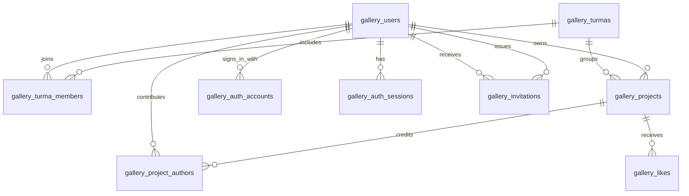

# Database guide

Toti Gallery uses PostgreSQL on Neon and Drizzle ORM. This guide explains the
11 application tables, their fields, and the relationships behind everyday
features. It describes the model in [src/db/schema.ts](../src/db/schema.ts), not
a live database inspection. Each environment must receive the relevant
[migrations](../migrations/README.md) before its structure matches this model.

This document contains schema information only: no user records, credentials,
connection strings, or usable tokens.

## How to read the model

- A **row** is one stored record, such as a person or project.
- A **primary key** uniquely identifies a row. Most tables use `id`; relationship
  tables instead use a combination of two fields.
- A **foreign key** points to a row in another table and prevents broken references.
- A **unique constraint** prevents duplicates. An **index** helps the database
  find matching rows; unique indexes also enforce uniqueness.
- **Nullable** fields may contain `NULL`, meaning no value is stored. An empty
  text value (`''`) is different from `NULL`.

Field names below use PostgreSQL's `snake_case`. In TypeScript, Drizzle usually
exposes the same field in `camelCase`: `author_id` becomes `authorId`. Better
Auth's `image` property is mapped to the existing `avatar` database column.

All `id` columns are text. `created_at` defaults to the insertion time. Where
present, `updated_at` also has an insertion default; later updates must be made
by the application or authentication library, rather than an automatic trigger
declared in this schema.

## Relationships at a glance

A person can belong to several turmas and contribute to several projects. Each
project belongs to one turma, has one publication owner, and can credit several
authors. Sign-in methods and sessions refer to the same permanent person record.
The diagram omits the optional project-to-moderator link and standalone Better
Auth verification and rate-limit tables for readability.

## People, groups, and projects

### 1. `gallery_users` — people and access

Students and staff share this table. A person keeps the same `id` when their name,
memberships, or sign-in methods change.

| Field | Meaning |
| --- | --- |
| `id` | Primary key: permanent person identifier. |
| `name` | Required display name. |
| `email` | Required unique email. Uniqueness also ignores case and surrounding spaces. |
| `email_verified` | Boolean; defaults to `false`. Records email verification. |
| `avatar` | Nullable photo URL. |
| `avatar_metadata` | Nullable metadata for a managed photo: object key, dimensions, bytes and format. Legacy photos keep null. |
| `bio` | Profile description; defaults to empty text. |
| `github` | Nullable GitHub profile link. |
| `role` | `user`, `admin`, or `owner`; defaults to `user`. |
| `status` | `pending`, `active`, or `suspended`; defaults to `pending`. |
| `is_demo` | Boolean; defaults to `false`. Marks demonstration profiles. |
| `created_at`, `updated_at` | Creation and last-update timestamps. |
| `cohort`, `year` | Nullable historical group/year fields; not used for current memberships or authentication. |

Roles determine permissions; status determines access. A pending user has not
activated their account, an active user can sign in, and a suspended user is
blocked. Demo profiles cannot sign in. The database permits **at most one owner**;
it does not require an owner row to exist. Passwords are stored separately.

### 2. `gallery_turmas` — course groups

| Field | Meaning |
| --- | --- |
| `id` | Primary key. |
| `name` | Required display name; unique ignoring case and surrounding spaces. |
| `number` | Required positive integer, unique across all courses. |
| `course_name` | Nullable course name, such as `Full Stack`; 2–100 trimmed characters when present. |
| `start_year` | Nullable start year; must be between 2000 and 2100 when present. |
| `graduation_year` | Nullable historical completion year; not a substitute for the start year. |
| `archived_at` | Nullable timestamp; `NULL` means the group is not archived. |
| `created_at` | Creation timestamp. |

Archiving preserves the group, memberships, and projects. Members of archived
turmas can still browse and publish projects.

### 3. `gallery_turma_members` — group memberships

| Field | Meaning |
| --- | --- |
| `turma_id` | Required foreign key to `gallery_turmas.id`. |
| `user_id` | Required foreign key to `gallery_users.id`. |
| `joined_at` | Membership creation timestamp. |

The primary key is `(turma_id, user_id)`: one person can join several groups but
cannot have duplicate membership in the same group. An index on `user_id` helps
find a person's groups.

### 4. `gallery_projects` — publications

| Field | Meaning |
| --- | --- |
| `id` | Primary key. |
| `slug` | Required unique identifier used in the public project URL. |
| `title` | Required project name. |
| `description` | Required project description. |
| `technologies` | Required JSONB array of technology names, represented as `string[]` in the application. |
| `cover_style` | Cover style identifier; defaults to `abstract`. |
| `image_url` | Nullable image URL. |
| `image_metadata` | Nullable managed-cover metadata, including the smaller card version. Files live in Object Storage. |
| `cover_framing` | Nullable display settings: horizontal/vertical position (0–100) and zoom (1–3). Null keeps the original placement. |
| `github_url` | Required code/repository URL. |
| `live_url` | Nullable link to the running application. |
| `featured` | Boolean; defaults to `false`. Used for `Destaques`. |
| `is_final` | Boolean; defaults to `false`. Marks a final course project. |
| `base_likes` | Integer; defaults to `0`. Initial like count used for demonstration content. |
| `author_id` | Required foreign key to the publication owner's user record. |
| `turma_id` | Required foreign key to the project's turma. |
| `visibility` | `published` or `hidden`; defaults to `published`. |
| `moderation_reason` | Nullable explanation recorded during moderation. |
| `moderated_by` | Nullable foreign key to the moderator's user record. |
| `moderated_at` | Nullable time of moderation. |
| `created_at`, `updated_at` | Creation and last-update timestamps. |

`author_id` identifies the **publication owner**, not the complete author list.
Only that owner can edit or delete the publication. Administrators can hide or
restore it. A hidden project must have a nonblank reason, moderator, and
moderation timestamp. These fields describe the latest moderation action; they
are not a full moderation history.

`is_final` is independent of authorship: individual and group projects can both
be final projects. URL formats and form rules are validated by the application;
the database's required text columns alone do not validate URLs.

### 5. `gallery_project_authors` — authorship credits

| Field | Meaning |
| --- | --- |
| `project_id` | Required foreign key to `gallery_projects.id`. |
| `user_id` | Required foreign key to `gallery_users.id`. |

The primary key is `(project_id, user_id)`, preventing duplicate credits. An index
on `user_id` helps find projects for a person's profile.

For a six-person final project, the application stores one publication, one
publication owner, and six credit rows, including the owner. The gallery shows
one project; each author's profile can show that same publication.

The application requires new coauthors to be eligible active members of the
project's turma. Existing credits do not reference membership rows, so later
membership changes or turma archiving cannot erase authorship. A coauthor can
leave the project without deleting the publication.

### 6. `gallery_likes` — visitor likes

| Field | Meaning |
| --- | --- |
| `project_id` | Required foreign key to `gallery_projects.id`. |
| `visitor_key` | Required browser visitor identifier. |

The primary key is `(project_id, visitor_key)`. A visitor identifier can have at
most one like per project. There is no user foreign key: likes do not require
sign-in. The visitor key is kept in a browser cookie; the like itself is stored
in PostgreSQL. Different browsers can have different keys for the same person.

The displayed total is `base_likes + count(gallery_likes rows for the project)`.
Consequently, demo totals do not necessarily correspond entirely to visitor rows.

## Authentication and activation

### 7. `gallery_auth_accounts` — sign-in methods

| Field | Meaning |
| --- | --- |
| `id` | Primary key for the sign-in record. |
| `user_id` | Required foreign key to `gallery_users.id`. |
| `account_id` | Required identity identifier for this provider. |
| `provider_id` | Required provider identifier, such as `google` or `credential`. |
| `password` | Nullable password hash, not a readable password. |
| `access_token`, `refresh_token`, `id_token` | Nullable OAuth token fields managed by Better Auth. |
| `access_token_expires_at`, `refresh_token_expires_at` | Nullable OAuth token expiration timestamps. |
| `scope` | Nullable OAuth permission scopes. |
| `created_at`, `updated_at` | Creation and last-update timestamps. |

The pair `(provider_id, account_id)` is unique. For a password account
(`credential`), `account_id` must equal `user_id`.

Google and password sign-in can have separate account rows pointing to **one
user profile**. The first verified Google sign-in activates an existing approved
profile; it does not create a second person. This admission rule is enforced by
the application, not by a foreign key alone.

### 8. `gallery_auth_sessions` — login sessions

| Field | Meaning |
| --- | --- |
| `id` | Primary key. |
| `user_id` | Required foreign key to the signed-in person. |
| `token` | Required unique session token. |
| `expires_at` | Required expiration timestamp. |
| `ip_address`, `user_agent` | Nullable client information. |
| `created_at`, `updated_at` | Creation and last-update timestamps. |

A person can have multiple sessions, for example on a phone and a laptop. Session
tokens are private credentials, not values to include in documentation or logs.

### 9. `gallery_auth_verifications` — temporary auth checks

| Field | Meaning |
| --- | --- |
| `id` | Primary key. |
| `identifier` | Required lookup identifier; indexed. |
| `value` | Required verification value managed by Better Auth. |
| `expires_at` | Required expiration timestamp. |
| `created_at`, `updated_at` | Creation and last-update timestamps. |

These are Better Auth's internal verification records. Administrator-issued
activation and recovery grants use the separate invitations table below.

### 10. `gallery_auth_rate_limits` — authentication throttling

| Field | Meaning |
| --- | --- |
| `id` | Primary key. |
| `key` | Required unique identifier for a request counter. |
| `count` | Required integer request count. |
| `last_request` | Required numeric request time, stored as a PostgreSQL bigint. |

Better Auth uses these counters to limit repeated requests. They are operational
records, not student or project content.

### 11. `gallery_invitations` — activation and recovery grants

| Field | Meaning |
| --- | --- |
| `id` | Primary key. |
| `user_id` | Required foreign key to the recipient. |
| `created_by` | Required foreign key to the issuing administrator. |
| `purpose` | `activation` or `password_reset`. |
| `token_hash` | Required unique 64-character lowercase hexadecimal token hash. |
| `expires_at` | Required expiration timestamp, later than `created_at`. |
| `consumed_at` | Nullable timestamp recording use. |
| `revoked_at` | Nullable timestamp recording revocation. |
| `created_at` | Creation timestamp. |

The database prevents a grant from being marked both consumed and revoked.
The application also validates expiry and makes redemption single-use.
Activation grants last 48 hours; password-recovery grants last one hour.

Raw tokens, complete links, and delivery status are not stored here. Grant
creation is independent of delivery: links are currently sent manually, and a
future email service can deliver the same kind of grant. See
[Authentication](authentication.md) for issuance and redemption behavior.

## What happens when records change or are deleted?

Foreign keys define database-level behavior:

| Operation | Result |
| --- | --- |
| Rename a person or turma | References continue to use the same IDs. |
| Archive a turma | Memberships and projects remain. Publishing remains available to members. |
| Remove a membership | Existing project credits remain independent. |
| Hide a project | The publication, author credits, and likes remain stored. |
| Delete a project | Its authorship links and visitor likes are deleted automatically (`CASCADE`). |
| Delete a referenced turma | Blocked while memberships or projects reference it (`RESTRICT`). |
| Delete a user | Blocked while restricted references exist, including owned projects, memberships, invitations, or moderator references. If deletion is otherwise permitted, their sign-in methods, sessions, and authorship links cascade. |

There is no general account-deletion feature. Administrative deletion of a
never-activated student has additional application checks. These foreign keys
do not implement a complete future account-deletion policy by themselves.

The database enforces valid references, uniqueness, and selected checks. Server
code additionally controls permissions, public visibility, coauthor eligibility,
and activation. A schema diagram alone does not describe all access rules.

## Environments and schema changes

Neon branches isolate environments. The public application uses
`production / toti_gallery`; local work uses the independent
`development / toti_gallery`. Temporary `test/*` branches are used for write tests
and migration verification. Data changes do not automatically synchronize
between branches, and changing `schema.ts` alone does not migrate a database.

See [Environments](environments.md) for connection guards and safe operations,
[Migrations](../migrations/README.md) for schema changes, and
[Administration](administration.md) for administrative workflows.
